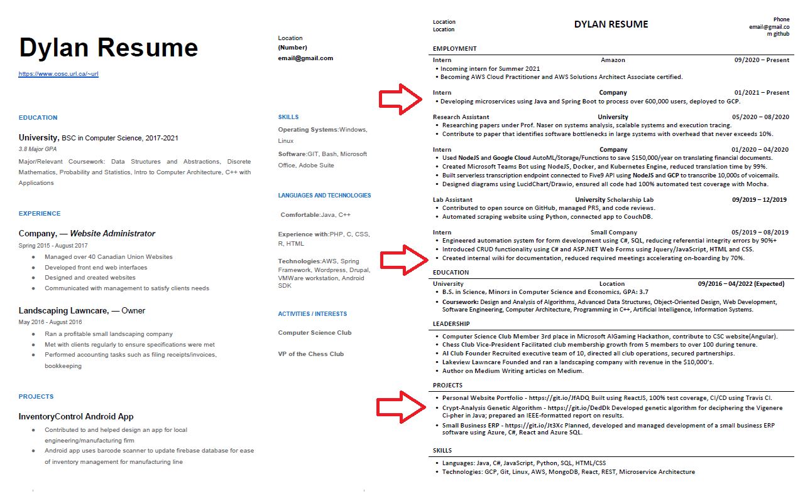
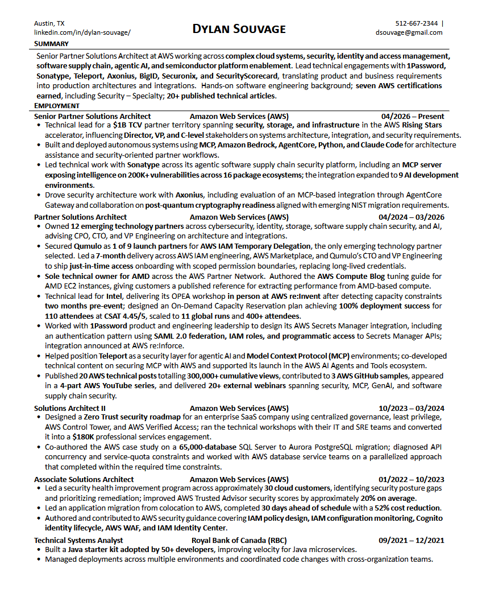
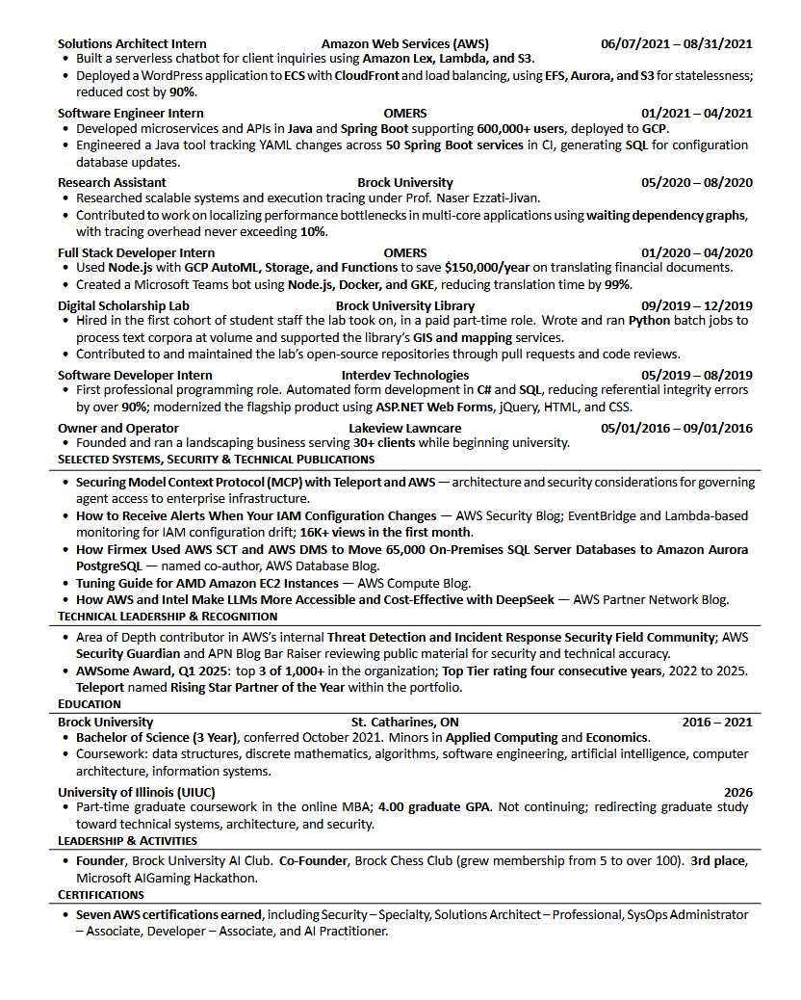

# Dylan's Resume Guide

> A practical guide for getting interviews at large tech companies. Some advice is big-company specific — it may or may not apply to smaller shops, but the fundamentals transfer anywhere.

This guide was originally written before AI coding assistants existed — based on real recruiter conversations, interview outcomes, and a lot of time on `/r/cscareerquestions`. The advice hasn't changed (resume fundamentals don't), but it now includes a Resumizer skill that any AI tool can use. Drop the skill file in and your AI assistant follows the same rules this guide does.

**The resume on the left below is what I had when I started at Brock University.** The one on the right is what it became after applying this guide — and it's what got me the Amazon offer. The emails above it are real.

<p align="center">
  
  
</p>

Later, a version of this resume — tailored for graduate admissions rather than internships — got me into Berkeley (MICS), USC, UIUC, and University of Washington.

One difference for grad school: **you want a CV, not a one-page resume.** Two pages is fine. Admissions committees want the full picture — publications, research, coursework, certifications, everything. The one-page rule is for recruiters who spend 6 seconds on a resume; an admissions reader is looking for depth. Below is the CV that got into those programs.

<p align="center">
  
  
</p>

---

## Contents

- [Why listen to this?](#why-listen-to-this)
- [Resumizer — AI skill](#resumizer--ai-skill)
- [Resume Guide](#resume-guide)
  - [1. Format](#1-format)
  - [2. Content and bullet points](#2-content-and-bullet-points)
  - [3. Projects](#3-projects)
  - [4. Skills](#4-skills)
  - [Quick reference card](#quick-reference-card)
- [Cover Letters](#cover-letters)
- [LinkedIn](#linkedin)
- [Useful Links](#useful-links)
- [FAQ](#faq)

---

## Why listen to this?

I landed internships coming out of a small Ontario university most people haven't heard of. That led to interviews and offers at Amazon, Microsoft, Meta, Google, Databricks, RBC, OPG, OMERS, and IBM. I've spoken with recruiters directly, attended events like Passport to Google, had my resume torn apart and rebuilt multiple times, and spent an embarrassing number of hours on `/r/cscareerquestions` and `/r/csmajors` so you don't have to.

The most important thing is to apply — a lot, early, and consistently. This guide helps you make sure each application has a real shot.

---

## Resumizer — AI skill

The `resumizer.md` file in this repo teaches any AI assistant how to rewrite resume content correctly: strong action verbs, quantified results, ATS-safe formatting, no invented metrics. It's a plain markdown file with the rules baked in. Paste it into whatever tool you use and it will follow this guide's standards.

| Tool | How to use it |
|------|---------------|
| [Kiro](https://kiro.dev) | Copy `resumizer.md` to `~/.kiro/skills/` (user-level) or `.kiro/skills/` (workspace) |
| [Claude](https://claude.ai) / [Claude Code](https://claude.ai/code) | Paste the contents into your system prompt or Project Instructions |
| [ChatGPT](https://chatgpt.com) | Add to a Custom GPT's instructions, or paste into a new conversation |
| [Gemini](https://gemini.google.com) | Paste into a Gem's instructions or at the start of a conversation |
| [Cursor](https://cursor.sh) / [Copilot](https://github.com/features/copilot) | Add to your `.cursorrules` file or Copilot instructions |
| Any other tool | Paste `resumizer.md` as a system prompt or context file |

What it does:

- Rewrites vague bullets ("Responsible for…", "Helped with…") into PAR-format bullets with action verbs and quantified results
- Removes AI-inflated language ("innovative," "transformative," "passionate about")
- Enforces ATS rules: single-column layout, standard section names, .pdf/.docx, no personal pronouns
- Asks for missing metrics before rewriting — never invents a number
- Handles bullet mode, section mode, full resume mode, review/audit mode, and tailor-to-job mode

**Example:**

```
Weak:   Responsible for helping the team improve the customer onboarding process.

Strong: Redesigned customer onboarding flow, cutting time-to-activation from 14 days
        to 3 and reducing support tickets by 40%.
```

See `resumizer.md` for the full spec and all modes.

---

## Resume Guide

### 1. Format

Keep it clean and standard. Recruiters go through thousands of applications — a dense or flashy layout works against you. Career centers at Harvard, MIT, Stanford, CMU, Yale, and Princeton all give the same core layout advice. Exceptions apply for UI/UX and visual front-end roles.

**Recommended templates:**
- [Jake's Resume (LaTeX)](https://www.overleaf.com/latex/templates/jakes-resume/syzfjbzwjncs) — widely used, clean, ATS-safe
- [Moharnab's template (Overleaf)](https://www.overleaf.com/articles/moharnab-resume/jswvscyqsryt)
- [Rezi.io](https://www.rezi.io/) — online builder with ATS optimization

Rules:
- Single column — no tables, columns, text boxes, or graphics; these break ATS parsers
- Submit as `.pdf` or `.docx` only — never `.pages`, `.txt`, or a Google Docs link
- Standard fonts: Calibri, Arial, Times New Roman, Cambria — 10-12pt, margins 0.5-1 inch
- Dates flush right on the same line as the role — never lead a line with a date
- Consistent formatting throughout: same font, same spacing, same bullet style
- Students and recent grads: **Education → Experience → Projects → Skills**
- No internships yet: **Education → Projects → Skills → Experience**
- One page if you have fewer than 10 years of experience; two pages only if the second page is genuinely full
- **For grad school applications: use a CV, not a one-page resume.** Two pages is expected. Admissions committees want publications, research, coursework, certifications — the full picture. The one-page rule is for recruiters, not admissions readers.

### 2. Content and bullet points

**Executive summary**

Put a 2-4 sentence summary at the top when your background has a real angle worth calling out — a pivot, an unusual combination of skills, or enough seniority that two standout facts frame everything below. Skip it if you're a student, a new grad, or your experience sections already tell the story. Never fill it with adjectives. If you can't write it without "passionate," "dynamic," or "results-driven," cut it.

```
Strong: Security researcher with a background in offensive tooling, now focused on
        detection systems. Previously red team at two Fortune 500s — now I build
        the things that catch people like me.

Weak:   Highly motivated professional passionate about leveraging cutting-edge
        technologies to drive transformative business outcomes.
```

Every experience bullet should follow PAR format (Project → Action → Result) — the same structure that MIT, Stanford (CAR), and Yale (XYZ) all recommend. Lead with the verb, describe the work, end with a quantified result.

**Structure:** `Action verb → what you did → quantified result`

Three types of quantification to aim for:
- Financial impact: dollar value, revenue, cost savings
- Efficiency: percentage improvement, time saved, error rate reduced
- Scale: team size, users, data volume, number of locations

Resources:
- [STAR/PAR format](https://en.wikipedia.org/wiki/Situation,_task,_action,_result)
- [Google's data-driven hiring](https://www.washingtonpost.com/business/capitalbusiness/an-inside-look-at-googles-data-driven-job-interview-process/2013/09/03/648ea8b2-14bd-11e3-880b-7503237cc69d_story.html)
- [185 resume action verbs](https://www.themuse.com/advice/185-powerful-verbs-that-will-make-your-resume-awesome)

Rules:
- Start every bullet with a strong, unique action verb — never "Responsible for," "Helped," "Worked on," or "Participated in"
- No personal pronouns — bullets are fragments ("Managed a team of 8" not "I managed a team of 8")
- No abbreviations — spell everything out for ATS
- 3-5 bullets per role; one to two lines each; more bullets on the most recent/relevant role
- Every bullet needs a metric, scope, or concrete outcome

Examples:
```
Used X technology to solve Y problem resulting in Z achievement.

Engineered internal transcription middleware connected to Five9 API using NodeJS
and GCP to transcribe 10,000s of company voicemails, saving 1,000s of employee
hours monthly.
```

Tailor to every job. This is the most repeated piece of advice across every university career center. Reorder sections, adjust bullets, and mirror the exact keywords from the job description. The resume you send to one company should not be the same one you send to another.

### 3. Projects

Include anything you can talk about in an interview. School projects count. Side projects count. Nothing needs to be 100% complete — it just needs to be real work you can explain.

Treat each project like a job entry: verb → what → result/scope. Link to a GitHub repo or demo if you have one.

Examples:
```
Built a Java application to create and traverse binary search trees using Preorder,
Postorder, and Inorder traversal algorithms.

Designed and deployed a personal portfolio site using React and GitHub Pages.
```

### 4. Skills

List anything you could speak to if an interviewer asked about it. Be honest about your depth — it's fine to note in person that something is introductory. A broad, honest list beats a short curated one.

Group by category for long lists: Languages, Frameworks, Tools, Platforms.

Don't list generic software — "Microsoft Office," "Google Docs," "communication skills" add no signal. List specific tools: Python, SQL, Tableau, AWS, Figma.

### Quick reference card

```
FORMAT:    Single column · 10-12pt · 0.5-1" margins · standard fonts · dates flush right
LENGTH:    1 page (students, <10 yrs) · 2 pages only if genuinely full
SECTIONS:  Contact > Education > Experience > Projects > Skills  [reorder per role]
BULLETS:   Action verb + context + quantified result · 1-2 lines · no pronouns · past tense
AVOID:     Objective statement · "References upon request" · photos · high school
           Passive verbs · generic skills (MS Office) · personal pronouns · abbreviations
           Columns/graphics/tables (break ATS)
QUANTIFY:  Financial impact · efficiency/percentage · scale (users, team size, data volume)
ATS:       Mirror job description keywords exactly · standard headings · text-based PDF
TAILOR:    New version per application · reorder sections · adjust bullets to match job
```

---

## Cover Letters

Skip it if you're applying in bulk. Write one if you genuinely want the role.

A practical approach: write three versions with fill-in-the-blank company/role details so you can customize quickly without starting from scratch each time.

Data definitely shows recruiters prefer cover letters, so I can't really argue against them.

Source: [Does a cover letter actually matter?](https://www.reddit.com/r/ITCareerQuestions/comments/nqxfb6/does_a_cover_letter_actually_matter_will_anyone/)

---

## LinkedIn

I am not as qualified to speak on LinkedIn as I believe all my success came from mass applying with a quality resume. However, these are some useful links and resources for anyone looking to upgrade their LinkedIn.

- Get a good profile photo — [Photofeeler](https://www.photofeeler.com/my-tests) lets you crowdsource feedback; recruiters spend roughly 20% of their time on your photo
- Add lots of skills and get endorsed for them
- Be detailed in your work experience with results, not just job descriptions
- Connect with everyone — there is no downside to more connections
- [What to do on LinkedIn every month, week, and day](https://www.themuse.com/advice/what-you-should-be-doing-on-linkedin-every-month-week-and-day)
- [4 elements of a killer LinkedIn summary](https://www.themuse.com/advice/4-key-elements-of-a-killer-linkedin-summary)

---

## Useful Links

**Communities:**
- [r/cscareerquestions](https://www.reddit.com/r/cscareerquestions/)
- [r/csmajors](https://www.reddit.com/r/csmajors/)
- [r/ITCareerQuestions](https://www.reddit.com/r/ITCareerQuestions/)

**Discords:**
- [CSMajors](https://discord.gg/Zukpvz9E47)
- [CSCareerQuestions](https://discord.gg/vq9VjeBWy9)
- [CS Careers Dev](https://discord.gg/CFuGHcmGCk)
- [UWaterloo](https://discord.gg/sAzqcCqS5W)

**Tools:**
- [ResumeWorded](https://resumeworded.com/) — automated resume feedback
- [CareerCup resume guide](https://www.careercup.com/resume)
- [Successful resume examples](https://www.careeers.org/resumes)
- [Breaking down a successful resume (LinkedIn post)](https://www.linkedin.com/posts/jonathan-wonsulting_resume-jobsearch-jwow-activity-6848632858454695936-CFjV)
- [Best time of day to submit applications](https://www.huffpost.com/entry/best-time-of-day-submit-job-application_l_60ae67d6e4b0d45b7531668c)

**University career guides:**
- [Harvard Career Services](https://careerservices.fas.harvard.edu/resources/create-a-resume-or-cv/)
- [MIT CAPD Resume Guide](https://capd.mit.edu/resources/resumes-cvs-cover-letters-and-linkedin/)
- [Stanford CareerEd](https://undergrad.stanford.edu/advising/cardinal-advising/career/resume)
- [CMU Career Center](https://www.cmu.edu/career/students-and-alumni/resume-resources/index.html)
- [Yale OCS](https://ocs.yale.edu/channels/resumes-cvs/)
- [Princeton Career Development](https://careerdevelopment.princeton.edu/guides/resume-cv)
- [Berkeley Career Center](https://career.berkeley.edu/develop-your-resume)

---

## FAQ

**What does your resume look like?**

Note: probably not up to date

https://www.cosc.brocku.ca/~ds16bz/resume/Dylan_Souvage_Resume.pdf

**Want a different guide?**

[CareerCup's resume guide](https://www.careercup.com/resume) is solid. [Careeers.org](https://www.careeers.org/resumes) has examples from people at top companies.

**Want to skip straight to a tool?**

[ResumeWorded](https://resumeworded.com/) gives automated line-by-line feedback. The `resumizer.md` skill in this repo does the same interactively with any AI tool.
